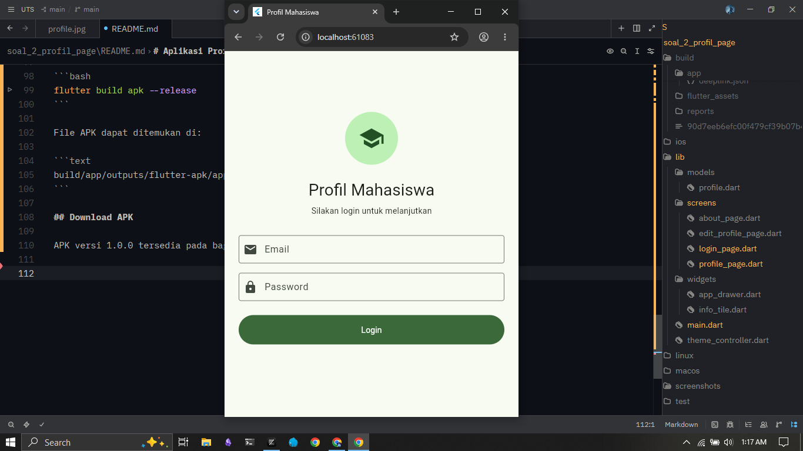
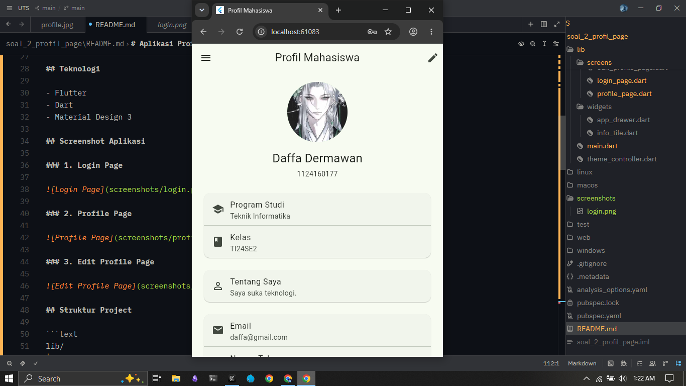
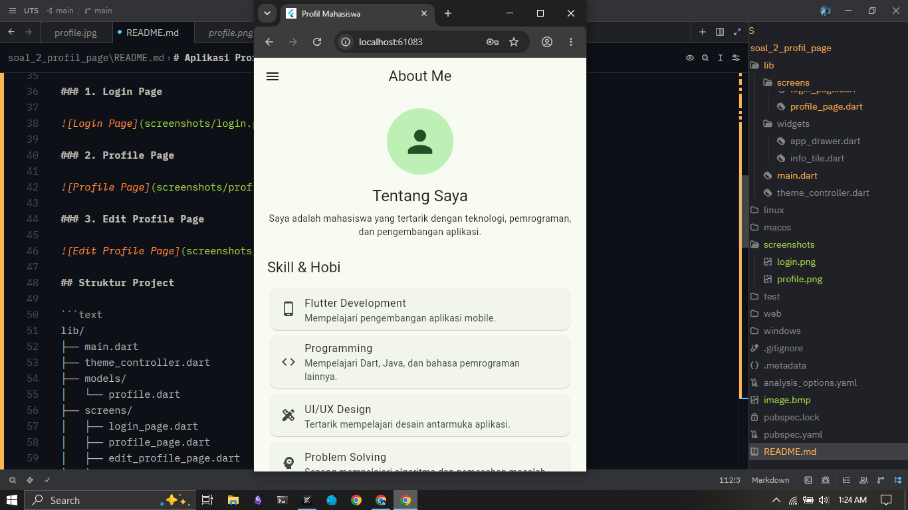

# Aplikasi Profil Mahasiswa

Aplikasi Profil Mahasiswa merupakan aplikasi mobile berbasis Flutter yang dibuat untuk memenuhi tugas Ujian Tengah Semester mata kuliah Pemrograman Mobile.

## Identitas Mahasiswa

- **Nama:** Daffa Dermawan
- **NIM:** 1124160177
- **Program Studi:** Teknik Informatika
- **Kelas:** TI24SE2
- **Perguruan Tinggi:** Global Institute

## Video Presentasi

[Link Video YouTube](https://youtu.be/_rOSUDc9c7o?si=c1D_VuT3uYYmu988)

## Fitur Aplikasi

1. **Login:** Halaman login dengan validasi email dan password.
2. **Profile:** Menampilkan informasi pribadi dan akademik mahasiswa.
3. **Edit Profile:** Mengubah data profil dengan validasi input.
4. **About Me:** Menampilkan keterampilan, hobi, dan riwayat pendidikan.
5. **Dark Mode:** Mengubah tampilan aplikasi menjadi mode gelap atau terang.
6. **Navigation Drawer:** Navigasi antarhalaman melalui Drawer.
7. **Logout:** Keluar dari halaman profil dan kembali ke Login.

## Teknologi

- Flutter
- Dart
- Material Design 3

## Screenshot Aplikasi

### 1. Login Page



### 2. Profile Page



### 3. About Page



## Struktur Project

```text
lib/
├── main.dart
├── theme_controller.dart
├── models/
│   └── profile.dart
├── screens/
│   ├── login_page.dart
│   ├── profile_page.dart
│   ├── edit_profile_page.dart
│   └── about_page.dart
└── widgets/
    ├── info_tile.dart
    └── app_drawer.dart
```

## Cara Menjalankan Aplikasi

Pastikan Flutter SDK sudah terpasang.

1. Clone repository:

```bash
git clone https://github.com/daffadermawan30/uts-pml-1124160177.git
```

2. Masuk ke folder project:

```bash
cd soal2_profil_app
```

3. Install dependencies:

```bash
flutter pub get
```

4. Jalankan aplikasi:

```bash
flutter run
```

## Build APK

Untuk membuat APK release, jalankan:

```bash
flutter build apk --release
```

File APK dapat ditemukan di:

```text
build/app/outputs/flutter-apk/app-release.apk
```

## Download APK

APK versi 1.0.0 tersedia pada bagian [GitHub Releases](https://github.com/daffadermawan30/uts-pml-1124160177/releases/tag/v1.0.1).
